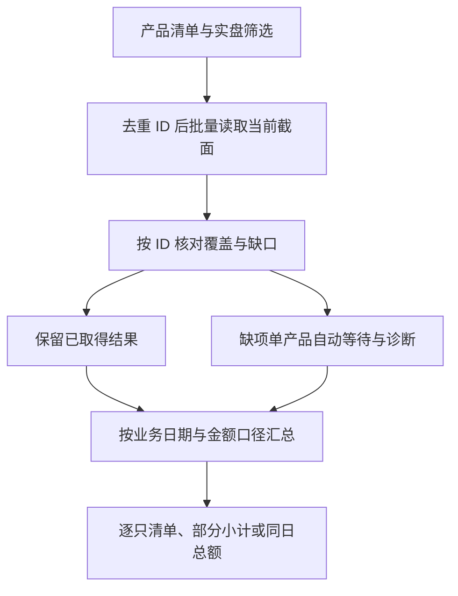

# 实盘产品规模：问“有哪些、各自多少、合计多少”时怎么查

> 学习案例。产品名、日期与金额均为**教学构造**，不是某个部署的执行回执；真实操作必须重新读取目标空间的数据。
>
> 下面先讲怎样拆问题、选能力、读证据和交付；脚本只在末尾作为可选对照。不读 `run.py`、不运行脚本，也能走完这条业务路径。

## 构造请求

> “看下当前实盘产品，各自多少规模，合计多少。”

这句话已经给出目标（逐只规模与合计）、范围（当前、实盘）和副作用（只读）。按[目标拆解](../README.md#1-翻译要产出什么)，能由请求和公开字段确定的口径就直接执行，不必先问角色、工具偏好或逐字段确认。只有会改变对象、范围或结论的信息才需要回到用户：例如用户说的“全部”如果指整个机构而不只是自己可见范围，本次只能说明可见边界；或者他明确要“总资产规模”，那就换成对应字段并调整勾稽说明，而不是把两种口径混在一起。

本例就是一个可以直接开始的请求。下面把“规模”落实成可核对的口径，再说明为什么选这些读取、怎样解释缺口。

## 1. 先拆口径：这句话里每个词落到什么证据

|要回答的问题|本例采用的口径|边界|
|---|---|---|
|谁的范围|当前身份在当前空间内**可见**的产品|可见范围 = 空间 ∩ 权限，不等于 AMS 全库，也不能称为“公司全部产品”|
|什么算实盘|产品 `label` **严格等于** `live`|`label` 只区分实盘/模拟；`product_state`、`closing_date`、`maturity_date`、`fund_code` 是彼此独立的维度，不能当成 `live` 的同义词|
|是否排除封账、终止、到期、零值或负值|请求没有要求排除，因此**不自行排除**，照原值列出|这些记录是否计入属于业务范围口径，不能按字段名猜；若结果里出现封账、终止或到期记录，先原样列出并注明，是否从本次范围排除交用户决定。若用户明确要“只看未封账/存续中”，那是另一个集合，确认后再改，不是默认动作|
|“规模”取什么字段|头寸报表的**净资产** `total_equity`，单位元|`units`、`unit_net_value` 不是本例口径；缺份额或净值不影响规模判定，也不能反过来说份额/净值已就绪|
|总资产、总负债有什么用|按[头寸字段定义](../../fields/balances.md#balance-calculation)做资产、负债与净资产的**勾稽检查**|勾稽只用于发现不一致，不证明估值输入齐全；差额不自动改写任何一边|
|当前结果还是最近结算|用户说“当前”，走省略 `date` 的实时语义；业务日期**以每次返回的 `date` 为准**|不能把请求日直接赋给结果；上一交易日概览是另一个口径，见第 2 节|
|什么时候能加总|请求集合内每只都有可用业务日期和**有限** `total_equity`，且业务日期完全一致时，才可称“同日总额”|覆盖不全或日期不同，只能给按业务日分组的小计，并把其余金额单列|
|金额是否可比|按人民币头寸口径（元）表述|不核验各产品记账币种与汇率设置；跨币种是否可直接相加需另行确认，不能因字段都是数字就默认可比|

关于时间，还要记住两条不扩大的边界：

- **“当前”不是严格同一原子时点。** 批量返回的每只产品各自带业务日期与重算时间 `update_time`；`update_time` 是头寸报表重算时间，不是行情 tick 时间。相同业务日期也不证明价格时点相同或全部估值输入已就绪。因此“同日总额”是按业务日期归组的结果，不是同一毫秒快照；若部分数值来自后续单读、补读或不同轮次，交付时注明读取批次，业务要求严格同一截面时重新批量读取全部成员，不能把不同时点的数字拼成原子快照。
- **历史日期与未来日期是另外的问题。** 本例不传未来日期；若用户明确要“昨天收盘的规模”，那是按历史日期读取并接受历史口径限制，不能拿实时结果冒充。

## 2. 选哪些能力，为什么不是产品组或账户

|要解决的问题|采用的能力|为什么不用别的|
|---|---|---|
|谁在我范围内、哪些是实盘|`products.list`，投影 `id`、`name`、`label` 等范围字段|它给的是**产品集合**，不是规模；返回里的 `total` 是本可见范围内的条数，不是金额。`permissions` 用于判断本人权限，不能用“读得到”推断“能改”|
|逐只规模与合计|固定去重后的产品 ID，调用一次 `balances.get` **数组形态**（批量实时截面），投影 `date`、`total_equity`、`total_assets`、`total_liabilities`、`update_time`|数组形态的返回是“资源 ID → 实时概览”加 `error_messages`、`pending_valuation` 两个诊断键，正好一次看多只产品的当前就绪情况|
|用产品组一次取合计|不使用产品组作为本次来源|产品组是**已知成员**的组合，回答的是组级结果；即使读成员视图，也只覆盖该组成员，不能替你枚举“当前全部可见实盘”。为一次汇总新建组属于写操作，需要授权并可能触发组重算，还把成员与权重变成新的业务对象|
|用账户作为选择单位|不使用账户|账户是产品内的流水归属配置，没有独立全局 ID，不能作为 `resource`，也没有独立的规模口径|
|某只产品为什么没结果|`products.compute_state` 查计算状态；对无明确错误的缺项，用**同字段**单产品 `balances.get` 读取实时 summary|状态查询不等待、不轮询；实时 summary 的 HTTP 202 由 SDK 自动轮询，结束后验收结果或交付排查方案，不再外层批量重试|
|需要最近结算参考|按需调用 `balances.previous_summaries`，单独成表|它读的是上一交易日概览，`date` 由服务端决定，只有估值就位的资源会出现；不能并入实时小计，更不能替代当前结果|

范围决定请求集合，返回结果决定缺口，缺口决定后续诊断；不同产品的诊断彼此独立：



汇总必须建立在证据之后，不能先假定所有产品都会返回，也不能先想好一个“合计”再往清单里凑数。

所以不要颠倒范围与取数。A 的 `compute_state` 与 B 的单资源读取可以同时发起，也可以按需要只做其中一项；信息已经足够时停止查询并开始汇总。

数组形态的参数面也更窄：只接受 `fields`，不能同时带 `date`、分类、基准或成员视图参数。所以“当前批量”与“某只产品的历史日期”是两条不同路径，不能用批量接口顺手改成历史口径。批量读取只用于这一次取数，**不要用逐只循环代替批量**；单资源读取只用于缺口诊断或复核，不是把批量接口再实现一遍。

## 3. 构造走查：结论怎样随证据变化

假设本次 `products.list` 后按 ID 去重，得到 6 只 `label=live` 的可见产品：A、B、C、D、E、F。下面所有名称、日期和金额都是构造值。

### 第一轮批量读取

|构造产品|返回业务日期|`total_equity`|`total_assets`|`total_liabilities`|观察|
|---|---|---|---|---|---|
|A|2026-10-30|1,250,000,000|1,400,000,000|150,000,000|勾稽相等|
|B|2026-10-30|980,000,000|1,060,000,000|70,000,000|勾稽差 10,000,000，单列|
|C|2026-10-30|0|0|0|零值原样保留，仍算已返回|
|D|—|—|—|—|未出现在结果中，落入 `pending_valuation`|
|E|2026-10-29|320,000,000|400,000,000|80,000,000|业务日期与其余不同|
|F|—|—|—|—|未出现在结果中，`error_messages` 有服务端原文（构造为“所需估值输入缺失”）|

先做对账：请求 6 只 = 返回 4 只（A、B、C、E）+ 明确错误 1 只（F）+ 未就绪 1 只（D），无重复、无同时出现在两处。`pending_valuation` 只表示“请求了但没返回且不在 `error_messages` 里”，**不是服务端确认正在计算的清单**。

这一轮能得出什么：

- 实际处于 2026-10-30 且金额可用的只有 A、B、C，小计为 **2,230,000,000 元**，覆盖 3/6。
- E 的 320,000,000 属于 2026-10-29，**单列**；不与 10-30 小计相加。
- D 未就绪，F 明确失败；都不能补 0，也不能当作“没有持仓”或“已删除”。
- 因此不能回答“合计 2,550,000,000 元”，更不能说这是“全量总额”。只能说：10-30 已就绪部分小计 2,230,000,000 元（3/6），10-29 单列 320,000,000 元，另有 1 只未就绪、1 只失败。

### 诊断后，证据变了，结论也跟着变

对 D 并行做两件事：`products.compute_state` 查状态，单产品 `balances.get` 用同样的字段读取实时 summary。假设历史估值任务已完成、状态为 `normal`，而实时 summary 仍返回“尚未就绪”：这时要区分**历史估值已算完**与**实时截面尚在按需加载**。由 SDK 按[单产品实时等待与诊断交付](#normal-realtime-wait)自动轮询，不在外层反复批量查询，也不只看 `normal` 就宣布完成。

假设随后 D 返回 2026-10-30、`total_equity` 为 500,000,000：

- 10-30 小计变为 **2,730,000,000 元**，覆盖 4/6；
- 仍然不是全量总额，因为 F 仍失败、E 仍是 10-29。

F 的原文如果指向缺少估值输入，等待不会让输入出现。需要补齐什么、是否获准修改或重算，属于另一个带授权的写操作；本例只读，不能自动改配置或提交重算。假设 F 补齐后返回 2026-10-30、`total_equity` 为 200,000,000：

- 10-30 小计变为 **2,930,000,000 元**，覆盖 5/6；
- 仍不能加总 E，因为 E 的当前证据仍是 10-29。

只有当 E 也取得 2026-10-30 的可用结果（假设为 330,000,000），6 只同业务日期且净资产都有限，才可以给出**按已返回净资产字段汇总**的同日总额 **3,260,000,000 元**，同时保留 B 的勾稽异常，不能称为“全部核验无误的规模”。如果 E 本次始终没有该日结果，就只交付分组小计和单列金额，不用“最接近的日期”拼出一个总额。

构造值里 B 的勾稽差 10,000,000 也要保留在原表：规模按返回的 `total_equity` 统计，同时单列“总资产 − 总负债”与净资产不一致。不要为了“凑平”把 B 改成 990,000,000，也不要用这个差额去修正其他产品。C 的零值同样保留；若构造为负值（例如 −2,000,000），也按原值计入小计，不因负值判为失败或剔除。

## 4. 缺项怎么诊断、什么时候停止

先对账，再诊断。每轮都核对“请求集合 = 返回 + `error_messages` + `pending_valuation`”；差集、重复 ID、同一 ID 同时出现在返回和错误里，都要单列，不猜原因。

|观察到的情况|诊断动作|等待与结论|
|---|---|---|
|有 `error_messages` 原文|保留原文；不凭单条错误直接认定配置根因，先看它指向哪个对象、日期和缺失输入|停止对该项重复读取；说明缺什么及影响。需要补资料或写入时走[写操作计划卡](../README.md#6-写操作计划卡)，不在只读路径里自行修改|
|未返回、且不在 `error_messages` 里（`pending_valuation`）|用 `products.compute_state` 查状态，并用**同字段**单产品 `balances.get` 读取实时 summary；这两件事互不依赖，可并行|HTTP 202 由 SDK 自动轮询；本次单读结束后不再外层批量重试。`pending_valuation` 不代表已有计算任务，不能当零头寸或已删除|
|`compute_state` 为 `normal`，但单产品实时 summary 仍未就绪|历史估值任务正常完成后，实时截面仍可能在按需加载；按[单产品实时等待与诊断交付](#normal-realtime-wait)等待结果|成功、明确失败或等待上限到达后结束；超时转排查，不只反复查状态|
|返回了，但 `date` 缺失/为 `null`，或 `total_equity` 缺失、为 `null` 或非有限值|保留缺失语义，单列该项|不能把请求日赋给结果，不能补 0，也不能进入同日小计；只缺资产或负债时保留净资产结果，注明勾稽未完成|
|单资源同口径读取已经返回完整字段|把它作为该项的后续证据，并注明读取时点|可补入逐只清单；它不与原批量声称同一原子时点|
|批量整体失败|保留接口原文与已落盘部分|重试时提交同一批量请求，不拆成逐只请求碰运气，也不宣称部分结果就是全量|

<a id="normal-realtime-wait"></a>

### 单产品实时等待与诊断交付

对已有历史估值任务的产品，`normal` 表示历史估值任务已正常完成；实时截面是另一份产物，访问时可能才开始按需准备。因此“历史已算完、实时暂未返回”应读取所需的实时结果，不需要重新提交重算。`normal` 也不是任意历史日期都有数据的保证，不能用它跳过缺输入或生命周期判断。

批量读取后，对无明确错误且未返回的产品，保持原字段与实时日期语义，调用一次单产品实时 summary。HTTP 202 的查询间隔和重查由 SDK 处理，配置见[等待任务与判断完成](../../connection.md#等待任务与判断完成)。不另设“normal 后再等一分钟”，也不在单读结束后再开批量重读循环。每项查询启动时按任务剩余时间裁剪等待预算，为诊断与交付留出余量；并发排队不能重新获得完整任务预算。

- 返回了可用业务日期与有限净资产，保留原返回日期并按前述规则汇总；不同批次注明来源。普通 HTTP 200 已返回但字段不足时，保留缺失或 null 并交付缺口，不把它当作 HTTP 202 无限重查。
- 出现明确错误或确认缺输入，保留原文并停止对该项重复读取；需要补输入、改配置或重算时另行取得授权。
- SDK 等待超时仍未取得实时结果，交付“本次等待期限内仍未就绪，需排查”，保留产品 ID、查询时间、已等待时长、最后计算状态、执行标识与服务端提示；不把超时断言成产品计算失败或服务端取消。
- 计算仍在运行时，先查原任务进度；状态正常但持续拿不到实时结果时，请管理员检查实时产物准备链路及依赖输入。错误指向业务资料时，核对产品起止日期、最近导入和必要输入，不仅凭等待时间推断配置根因。
- 网络失败先核对连接与错误详情；剩余预算不足未能等待时明确说明“未充分等待”，不能据此认定产品异常。

保留首轮已就绪项与后续单读来源；若业务另行要求重新取得同一批次，则整体重读并重新验收，仍不承诺原子时点。首轮齐全时直接汇总。等待结束就输出已有结果与逐项排查方案，诊断受本次整体预算约束，做不完就明确标注，而不是空等。

不换口径凑数：不换请求日期、不用上一交易日概览替代当日结果、不补零、不把缺项解释成零头寸，也不通过改配置或重算来制造“完整”。到截止就交付缺口：停止等待只表示本次采集结束，不代表服务端失败或取消；已取得部分照原样保留，剩余项明确标注。

相关通用判断在[任务完成条件](../README.md#task-readiness)与[未就绪与缺输入](../../connection.md#unready-inputs)；这里只把规则落到本例的具体证据上。

## 5. 怎样把结果答复成业务结论

按[结果翻译](../README.md#7-结果翻译)，把“查到了什么”和“能得出什么”分开说：

- **逐只清单保留请求全集。** 6 只都要出现，包括 D 未就绪、F 失败；不能只列成功项，也不能用“其他正常”代替明细。
- **每只写清业务日期、净资产、状态。** 金额单位统一为元；不同日期的金额单列，不跨日相加。
- **分组小计与覆盖同时给。** 例如“10-30 已就绪 3 只，小计 2,230,000,000 元，覆盖 3/6；10-29 另有 1 只 320,000,000 元”；明确说明这不是同日全量总额，以及原因。
- **勾稽差单列。** B 的 10,000,000 差额说明返回字段之间不一致，但不改变本表按 `total_equity` 统计的口径；是否进一步排查由用户决定。
- **剩余动作具体。** D 继续有界等待或接受缺口；F 核对缺失输入并在获得授权后处理；E 确认其业务日期归属。不要把“再看看”当结论。
- **不扩大能力。** 当前身份看不到的产品不能凭空补进清单；跨币种不可比时不宣称总额；同日金额也不代表份额、净值或全部估值输入完整。

一个符合上述口径的构造答复可以是：

> 本次可见范围内 `label=live` 的产品共 6 只。2026-10-30 已有 3 只取得可用净资产，小计 2,230,000,000 元；另有 1 只落在 2026-10-29（320,000,000 元，单列）、1 只未就绪、1 只服务端明确报错。因此本次不能给出同日全量总额。B 的总资产减总负债与净资产相差 10,000,000 元，已单列待核。后续需确认 D 是否产出当日截面、F 的缺失输入由谁补齐、E 的业务日期归属；在此之前不改配置、不重算、不补零。

## 6. 本例不做的事

- 不新建产品组来“生成一个合计”，也不修改成员、权重或产品配置。
- 不提交重算、不改产品日历、账户或估值输入、不写估值报告；需要这些动作时，另行取得授权并说明影响范围。
- 不用 `previous_summary`/`previous_summaries` 顶替当前结果；它们只在用户明确需要最近结算参考时另表列出。
- 不把零值、负值、已封账或到期记录静默剔除，也不把它们自动判为异常。
- 不把“可见”说成“全库”，不把“同日就绪”说成“输入齐全”，不把“脚本跑完”说成“业务完成”。

## 可选：对照脚本

理解上面的路径后，可以查看或运行 `run.py` 对照一次受控采集。它不是完成业务任务的唯一入口，也没有实现上面的所有分支（例如不负责补齐缺失输入或修改配置）。

```console
export RQAMSH_TOKEN=<本次运行令牌>

python docs/demo/live-product-scale/run.py \
  --base-url https://ams.example.com \
  --workspace-id <空间 ID> \
  --output ./live-scale.md \
  --evidence ./live-scale.json \
  --deadline 180
```

追加 `--include-settled-reference` 时，额外输出一张“最近结算参考”表，仍与小计分开。

- 令牌只从 `RQAMSH_TOKEN` 或同一部署已保存身份取得；不读取内部凭据文件，也不写入报告或证据。
- `--output` 与 `--evidence` 必填且路径必须尚不存在，命令拒绝覆盖旧文件；地址、空间与文件名都要替换为本次已授权的目标。
- `--deadline` 是整条命令的限时（秒），覆盖鉴权、接口等待、加工与输出，不是单个接口的超时。
- 脚本只调用只读操作：产品清单、交易日历、批量/单只头寸、计算状态与上一交易日概览。
- 报告包含重点摘要（最多三条）、业务口径与边界、请求/返回对账（含每轮差集与错误原文）、逐只清单（含未返回项）、按业务日期分组小计、覆盖与总额判定、最近结算参考（启用时）及阶段耗时与缺口。
- 报告状态为 `complete`、`partial`、`failed` 或 `timeout`：`complete` 表示本次范围内每只都取得可用日期与有限净资产且无遗留缺口；`partial` 是正常结果，表示缺口被如实记录；`failed` 表示采集异常；`timeout` 表示到达硬截止，只说明停止采集，不代表服务端取消或失败。限时内跑完也不等于内容完整，完整性仍看覆盖计数与同日判定。
- 证据 JSON 记录每个操作的原始响应、问题、阶段与逐只结论，可能包含真实产品 ID、名称与金额，只留本地，不复制到公开文档或对话。

契约以[产品清单](../../products.md#list)、[头寸报表](../../balances.md#get)、[批量实时截面](../../balances.md#批量实时截面)、[上一交易日概览](../../balances.md#previous_summaries)、[计算状态](../../products.md#compute_state)、[头寸字段](../../fields/balances.md#balance-calculation)、[未就绪与缺输入](../../connection.md#unready-inputs)与[可见不等于可写](../../permissions.md#可见不等于可写)为准；本页不维护第二套字段或错误规则。
